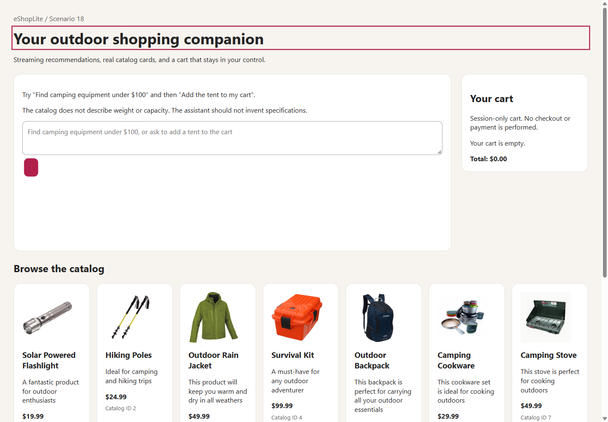
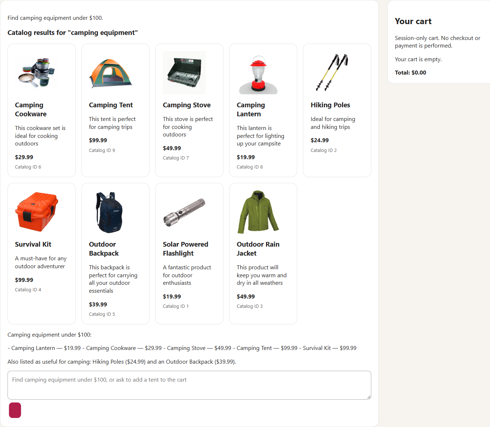
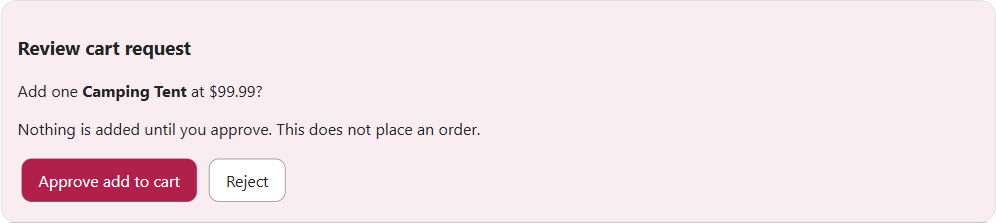
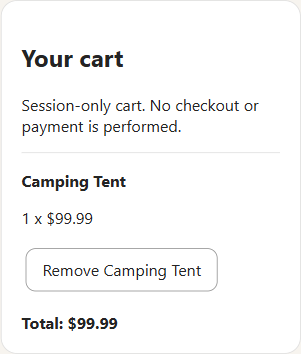

# Scenario 18: screenshot walkthrough

[Quick start](../README.md) | [Requirements and troubleshooting](REQUIREMENTS_AND_TROUBLESHOOTING.md) | [Code walkthrough](CODE_WALKTHROUGH.md) | [Detailed notes](DETAILS.md)

These screenshots show the real SQL/Foundry mode with synthetic shopping prompts,
`gpt-6-luna`, and `text-embedding-3-small`. They are application captures, not mockups.
Model wording, tool choices, result order, and response times can differ between runs.
The screenshots intentionally omit credentials and the dashboard login URL.

## 1. Open Store

Complete the [quick start](../README.md), open the dashboard printed by `aspire start`,
and select the **store** HTTP endpoint after the resources are healthy.
The Store opens with chat on the left, a session cart on the right, and the catalog below.
Normal mode has no offline-fixture banner.



Ports are assigned at startup. Do not copy a localhost port from another run.

## 2. Ask for catalog-backed recommendations

Send:

```text
Find camping equipment under $100.
```

Wait for the model and catalog tools to finish. The resulting cards contain IDs,
prices, descriptions, and images from Products, not model-generated product markup.
The cart stays empty when you only search.



The deliberately small semantic index can surface broader outdoor matches as well
as camping equipment. The assistant's wording and number of requested cards may vary.
Price and result bounds are enforced by application code.

## 3. Review before adding

Send:

```text
Add the Camping Tent to my cart.
```

The assistant reads the product and requests a frontend action. **Review cart request**
shows the catalog product and price, with separate Approve and Reject controls.
Nothing has been added at this point.



Click **Reject** to leave the cart unchanged. To demonstrate addition afterward,
ask again, wait for a new approval panel, then click **Approve add to cart**.
The screenshot below shows the approval path with one tent, not an order or payment.



The cart is session-only and its price is reloaded from the catalog. A new circuit or
restart does not restore it. Check the cart before repeating a request if a later
model response fails.

## 4. Check that missing facts stay missing

Send the third quick-start instruction:

```text
What is the exact weight and person capacity of the Camping Tent? Only use catalog facts.
```

The catalog includes a name, short description, price, ID, and image. It contains
neither weight nor person capacity. The expected response acknowledges that gap
instead of fabricating specifications. This request must not change the cart.


This is a useful grounding check, not a guarantee that a model can never hallucinate.
For the application-enforced boundaries, read the
[approval and catalog code walkthrough](CODE_WALKTHROUGH.md#5-inspect-the-approval-boundary-carefully).

## Finish

From the scenario folder, run:

```powershell
aspire stop
```

If a step differs from these captures, use the
[troubleshooting guide](REQUIREMENTS_AND_TROUBLESHOOTING.md#troubleshooting).
To understand the components behind each screen, follow the
[blog-to-code map](CODE_WALKTHROUGH.md#what-the-blog-explains).
